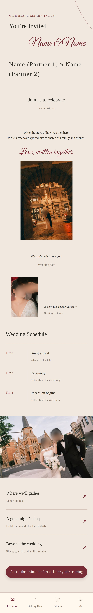
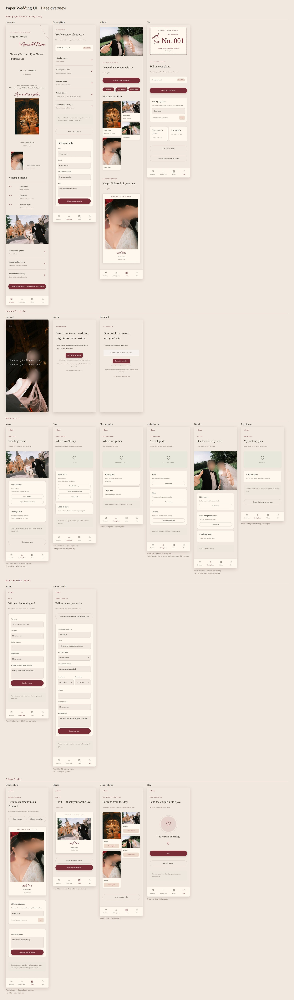

# Paper Wedding UI · a paper-style wedding mini-program design skill

English · [中文](README.md)

Describe your wedding details and the screens you need in plain language, and get zoomable long-image UI blueprints, self-contained HTML previews and a design spec. Warm beige paper, burgundy accents, thin serif type and handwritten script give it one consistent look. Works in **English and Chinese**.

This repo is a **design skill**. It ships no wedding backend: photo upload, pick-up forms, guest numbers and sharing are example states in the blueprints and never call any API.

## Preview

All text is placeholder copy. The photos are the author's preview photos with faces blurred (not covered by the MIT license — see [ASSETS.md](ASSETS.md)).

| Invitation | Getting Here | Album | Me |
|---|---|---|---|
| [full size](docs/previews/photos-en/01-invitation.jpg) | [full size](docs/previews/photos-en/02-travel.jpg) | [full size](docs/previews/photos-en/03-album.jpg) | [full size](docs/previews/photos-en/04-mine.jpg) |



### The full flow: 4 main pages + 15 secondary pages

Every `↗` entry and button opens a secondary page: venue, stay, arrival guide, RSVP, arrival details, share a photo, couple photos, a small game, plus the opening screen and sign-in. The HTML files link to each other, so the output behaves like a clickable prototype. `overview.jpg` lays everything out on one sheet and labels each secondary page with where it is opened from.



Photo-free versions (placeholder boxes only): [overview](docs/previews/placeholder-en/overview.jpg) · [Invitation](docs/previews/placeholder-en/01-invitation.jpg).

## Getting started

### Option 1: let an AI assistant use it (recommended)

Put the whole `skills/paper-wedding-ui` folder where your assistant looks for skills, then start a new session:

| Tool | Where |
|---|---|
| Codex | `~/.codex/skills/paper-wedding-ui` |
| Claude Code | `~/.claude/skills/paper-wedding-ui` (all projects) or `.claude/skills/paper-wedding-ui` inside a project |
| Claude.ai | zip the `paper-wedding-ui` folder and upload it in the Skills settings |
| Other agents | hand over `SKILL.md` and follow the tool's own skill-install method |

Then ask, for example:

> Use paper-wedding-ui to design an English wedding mini-program with three tabs: Invitation, RSVP and Album. Use placeholder names and photos.

The assistant needs to run Node.js and a browser. The renderer looks for one on its own (Playwright's Chromium → installed Chrome → installed Edge → a global Playwright), so it also works in sandboxes that cannot download a browser but ship one.

### Option 2: run it yourself

Requires Node.js 20 or newer. In `skills/paper-wedding-ui`:

```sh
npm install
npx playwright install chromium   # skip if Chrome/Edge is installed; see Troubleshooting
npm run render:en                 # English template → output-en/
npm run preview:en                # English, with the bundled (face-blurred) preview photos
npm run render                    # Chinese template → output/ (19 pages + overview.jpg)
```

Copy `examples/template.en.json` somewhere, edit it, then:

```sh
node scripts/render.cjs --config /path/to/my-wedding.json --out /path/to/my-design
```

## What you can change

- Names, date, address, contact details and story copy.
- UI language (`locale`: `zh` or `en`) and any built-in default sentence (`strings`).
- Navigation items, labels, icons and order; extra secondary pages.
- Timeline, album, pick-up form, lodging cards, signature, guest number and Polaroid frame modules, plus the secondary-page modules: opening splash, sign-in gate, detail panels, RSVP/arrival forms and a small game.
- Remove secondary pages you don't need, or point any entry at a new page with `page`.
- Colors, photo focal points, canvas width and export scale.

See the [configuration reference](skills/paper-wedding-ui/references/configuration.md) and [design language](skills/paper-wedding-ui/references/design-language.md) (the reference docs are currently written in Chinese; JSON field names are language-neutral and the `strings` table lists the English defaults).

Photos go in the config's `photos` map and are referenced from modules by key:

```json
{ "locale": "en",
  "photos": { "hero": "photos/us.jpg" },
  "pages": [{ "id": "home", "title": "Invitation",
    "modules": [{ "type": "hero" }, { "type": "photo", "photo": "hero", "position": "50% 30%" }] }] }
```

Paths are relative to the config file. Photos wider than the output are downscaled automatically; your originals are never modified.

## Troubleshooting

**"Could not launch a browser"** — Run `npx playwright install chromium`, or use an installed browser with `--browser chrome` / `--browser msedge`, or point to one with `--browser-path <executable>` (or the `CHROMIUM_PATH` environment variable).

**Lines starting with `⚠`** — They don't stop the render, but usually mean a typo: a module references a photo key that isn't in `photos`, or a photo is defined and never used.

**Chinese text looks different or shows boxes** — Chinese uses system serif fonts. On Linux install one, e.g. `sudo apt install fonts-noto-cjk`. Latin text in `locale: "en"` uses Georgia / Times.

**"exceeds 30000px"** — Lower `scale` or split the page into several pages.

**The buttons don't do anything** — The output is a static design blueprint, not a running mini program. Only entries that carry a `page` (the `↗` rows, the bottom navigation and some buttons) jump between the HTML files.

## Layout

```text
skills/paper-wedding-ui/
  SKILL.md                 instructions for agents
  agents/openai.yaml       skill display info
  references/              style and module configuration
  examples/                Chinese + English placeholder configs (4 main + 15 secondary pages), photo demo config
  assets/                  stylesheet, OFL font, author preview photos
  scripts/render.cjs       blueprint exporter
  scripts/test.cjs         config/customization tests (npm test)
  package-lock.json        pinned dependencies — commit it
```

## Author

Designed and curated by Emma (GitHub: [@EmmaWubobo](https://github.com/EmmaWubobo)).
Contact: m1559_e0fbouvmrf@aka.yeah.net
Built with AI assistance. Issues and showcases of what you made with it are welcome.

## License

Code and docs: MIT. The preview photos are excluded and described in [ASSETS.md](ASSETS.md); the bundled font is under the SIL OFL. The repo contains no API keys, AppIDs or cloud environments. Changes: [CHANGELOG](CHANGELOG.md).
