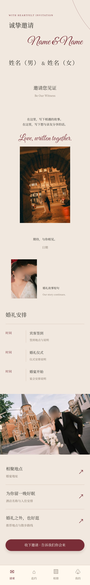
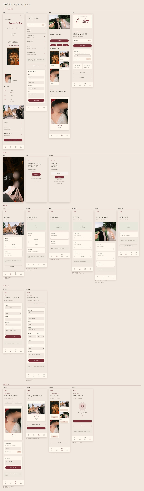

# Paper Wedding UI · 纸感婚礼小程序设计技能

[English](README.en.md) · 中文

用自然语言描述婚礼资料与功能需求，生成可放大查看的小程序UI长图、HTML预览和设计规格。暖米色、酒红、细衬线与手写英文构成统一风格。支持**中文和英文**两种界面语言。

本仓库是**设计技能**，不包含婚礼后台服务。照片上传、接送提交、编号、分享等在图纸中是示例状态，不会调用API。

## 效果预览

所有文字均为占位信息。下图使用作者保留的预览照片，人物面部已做模糊处理；照片不属于代码的MIT许可，使用范围见[素材说明](ASSETS.md)。

| 请柬 | 赴约 | 相册 | 我的 |
|---|---|---|---|
| [高清原图](docs/previews/01-invitation.jpg) | [高清原图](docs/previews/02-travel.jpg) | [高清原图](docs/previews/03-album.jpg) | [高清原图](docs/previews/04-mine.jpg) |



### 完整流程：4 个主页面 + 15 个二级页面

每个 `↗` 入口和按钮都会打开一个二级页面：场地、住宿、抵达指南、回执、到达登记、分享照片、新人合照、互动游戏，以及开屏与登录。输出里的 HTML 页面之间可以点击跳转，像一个可点击的原型。`overview.jpg` 把它们排在一张图里，并在每个二级页面下标出“从哪里进入”。



不含任何照片的占位版总览：[中文](docs/previews/placeholder-zh/overview.jpg) · [English](docs/previews/placeholder-en/overview.jpg)

不含任何照片的占位版：[中文](docs/previews/placeholder-zh/01-invitation.jpg) · [English](docs/previews/placeholder-en/01-invitation.jpg)（各含四个主页面和总览图）。英文界面的照片版见 [docs/previews/photos-en](docs/previews/photos-en/)。

## 开始使用

### 方式一：让AI助手使用（推荐）

把 `skills/paper-wedding-ui` 整个文件夹放到助手的技能目录，然后重新打开会话：

| 工具 | 放在哪里 |
|---|---|
| Codex | `~/.codex/skills/paper-wedding-ui` |
| Claude Code | `~/.claude/skills/paper-wedding-ui`（所有项目）或项目内的 `.claude/skills/paper-wedding-ui` |
| Claude.ai | 把 `paper-wedding-ui` 文件夹压缩成zip，在技能（Skills）设置里上传 |
| 其他代理工具 | 把 `SKILL.md` 交给它，按其本地技能安装方式使用 |

然后直接说：

> 使用 $paper-wedding-ui，生成完整的婚礼小程序设计长图，包含四个主页面和各个入口的二级页面。姓名、日期、地址使用占位词，照片使用占位图。

> Use paper-wedding-ui to design an English wedding mini-program: Invitation, RSVP and Album tabs. Use my photos in the folder I attached.

助手需要能运行 Node.js 和浏览器。渲染器会自动寻找可用的浏览器（Playwright自带Chromium → 本机Chrome → 本机Edge → 全局Playwright），无法联网下载浏览器的沙箱里也能使用已预装的浏览器。

### 方式二：不使用AI，直接运行

需要 Node.js 20 或以上版本。进入 `skills/paper-wedding-ui`：

```sh
npm install
npx playwright install chromium   # 已安装Chrome/Edge可跳过，见下方“常见问题”
npm run render                    # 中文占位模板  → output/
npm run render:en                 # English模板   → output-en/
```

`npm run preview`（中文）和 `npm run preview:en`（英文）显式使用随附的作者照片生成示例。每次会生成 19 页 PNG/HTML 和一张总览图，耗时约半分钟。依赖安装需要网络，渲染本身只读取本地素材。

复制 `examples/template.json`（或 `template.en.json`）到自己的工作目录，修改后运行：

```sh
node scripts/render.cjs --config /path/to/my-wedding.json --out /path/to/my-design
```

## 定制示例

> 使用 $paper-wedding-ui。新人称呼改为我提供的资料；只保留请柬、行程、相册三个导航，增加住宿登记页面。使用我的照片，输出1170像素宽PNG和设计规格。

> 使用 $paper-wedding-ui，保留占位文字，使用随附预览照片，生成完整预览和总览图。不要连接任何后台。

未提供资料时使用“姓名（男）”“姓名（女）”“日期”“婚宴地址”等占位词（英文为 “Name (Partner 1)” 等）。不会推测个人信息。

## 可以改哪些内容

- 姓名、英文称呼、日期、地址、联系方式、故事文案。
- 界面语言（`locale`）和任何一句内置默认文案（`strings`）。
- 导航数量、标题、图标、顺序；可新增二级页面。
- 时间轴、相册、接送表单、住宿卡片、署名、编号、拍立得等模块，以及开屏、登录、详情卡片、回执表单、互动游戏等二级页面模块。
- 删掉不需要的二级页面，或用 `page` 把任何入口接到新页面。
- 配色、照片取景位置、画布宽度与导出倍率。

详见[设计语言](skills/paper-wedding-ui/references/design-language.md)和[配置说明](skills/paper-wedding-ui/references/configuration.md)。输出是自适应文档流，不会因增加流程或修改姓名就固定截断页面。

## 常见问题

**提示“无法启动浏览器”**　任选其一：`npx playwright install chromium`；或用本机浏览器 `--browser chrome` / `--browser msedge`；或 `--browser-path <浏览器可执行文件>`（也可设置环境变量 `CHROMIUM_PATH`）。

**中文字形和预览图不一样，或显示成方块**　中文使用系统衬线字体（宋体/Songti/Noto Serif CJK）。Linux 上请安装一款中文字体，例如 `sudo apt install fonts-noto-cjk`。需要在所有系统上字形完全一致时，自行提供有授权的字体并改 `assets/style.css`。

**输出里出现 `⚠` 提示**　不影响渲染，但通常是拼写问题：模块引用了 `photos` 里没有的照片键，或定义了照片却没有任何模块使用它。

**导出报“超过30000像素”**　降低 `scale`，或把内容拆成多个页面。

**照片太大、HTML很重**　渲染时会自动把超过输出宽度的照片缩小，不改动原文件。

**为什么按钮点了没反应**　输出是静态设计图纸，不是可运行的小程序。只有写了 `page` 的入口（`↗` 行、底部导航、部分按钮）能在 HTML 间跳转。

## 文件结构

```text
skills/paper-wedding-ui/
  SKILL.md                 代理执行说明
  agents/openai.yaml       技能展示信息
  references/              风格与模块配置规范
  examples/                中文/英文占位配置（4个主页面+15个二级页面）和照片演示配置
  assets/                  样式、OFL字体、作者预览照片
  scripts/render.cjs       高清图纸导出
  scripts/test.cjs         配置与定制验证（npm test）
  package-lock.json        锁定依赖版本，请一并提交
```

## 作者

设计与整理：Emma（GitHub：[@EmmaWubobo](https://github.com/EmmaWubobo)）
联系：m1559_e0fbouvmrf@aka.yeah.net
本项目由AI辅助实现。欢迎在Issues里反馈问题，或分享你用它做出的设计。

## 分享到GitHub

只上传本仓库目录，不上传自己的婚礼部署工程。保留LICENSE、ASSETS.md和字体OFL许可证。私人配置及新项目照片请放在仓库之外；不要把真实宾客数据、密钥、云环境或历史日志加入仓库。

代码和文档采用MIT许可；预览照片单独说明，字体按OFL。仓库未配置任何原作者API、AppID或云环境。更新记录见[CHANGELOG](CHANGELOG.md)。
